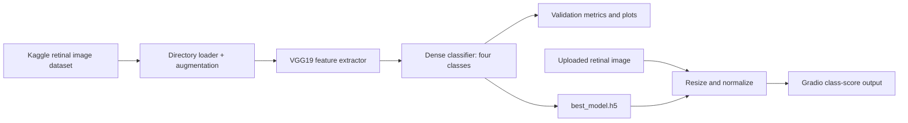
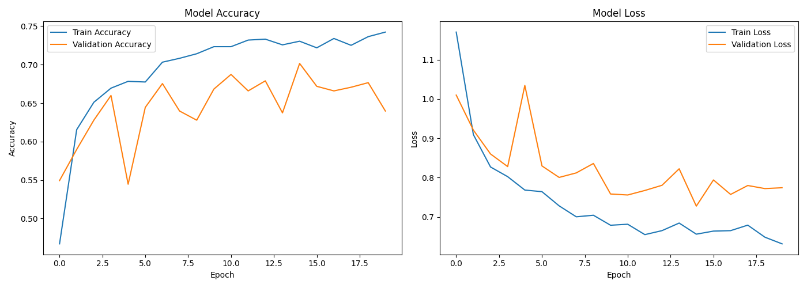
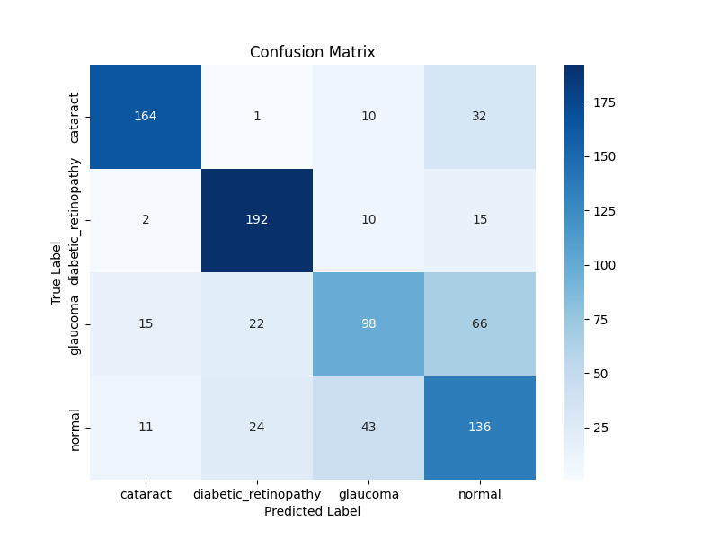

# Multi-Class Eye Disease Detection

**A VGG19 transfer-learning experiment for classifying retinal fundus images.**

## Overview

The notebook trains a four-class image classifier for cataract, diabetic retinopathy, glaucoma, and normal retinal images. It uses a Kaggle dataset, image augmentation, and a frozen ImageNet-pretrained VGG19 feature extractor with a custom classification head. A Gradio demo script accepts an image and returns class scores.

This is an educational prototype, not a diagnostic tool. Predictions require validation by qualified eye-care professionals.

## Key features

- Resize and normalize images to 224 × 224 with training-time augmentation.
- Train a VGG19-based four-class classifier with early stopping and best-model checkpointing.
- Review validation accuracy/loss curves, a confusion matrix, and a classification report.
- Run image predictions through a Gradio interface.

## Tech stack

Python, TensorFlow/Keras, NumPy, pandas, Matplotlib, Seaborn, scikit-learn, Pillow, and Gradio. The training notebook also uses Google Colab and Kaggle.

## Architecture and workflow



## Project structure

```text
.
├── Eye_Disease_Detection.ipynb  # Training, evaluation, and Colab demo workflow
├── demo.py                      # Gradio inference interface
├── accuracy_loss_plot.png       # Training and validation curves
└── confusion_matrix.png          # Validation confusion matrix
```

## Installation and execution

The training notebook is designed for Google Colab. Open it, provide Kaggle credentials, and run the cells to download the dataset, train the model, and save `best_model.h5`.

For the standalone demo, install the runtime dependencies and place the trained model beside `demo.py`:

```bash
python -m venv .venv
# Activate the environment for your shell, then:
python -m pip install tensorflow numpy gradio pillow
python demo.py
```

The repository does not include the Kaggle dataset or `best_model.h5`; the demo requires the model artifact generated by the notebook.

## Screenshots and demo

Validation artifacts from the repository:





No hosted demo link is included.

## Author

**Gireesh Sadanand Patgar** · [GitHub](https://github.com/gireeshpatgar17)
